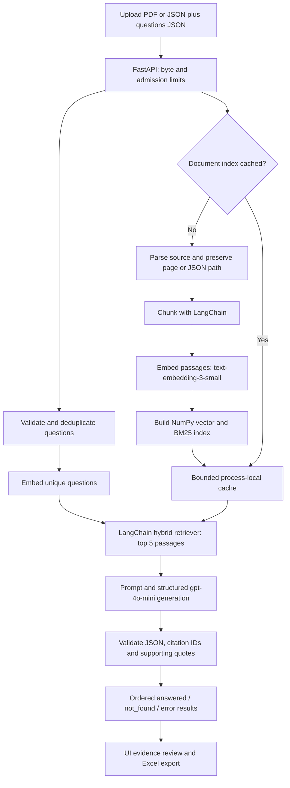

# Document RAG

A FastAPI service and upload interface that answers a JSON list of questions from one uploaded PDF or JSON document. A LangChain workflow retrieves evidence and uses `gpt-4o-mini` to produce structured answers with PDF page or JSON path citations. Successful answers are preserved when individual questions fail. The UI can add follow-up questions and download results as an Excel workbook.

## Requirements

- Python 3.11 or later, or Docker
- An OpenAI API key with access to `gpt-4o-mini` and `text-embedding-3-small`

Create a key at the [OpenAI API keys page](https://platform.openai.com/api-keys), or use a challenge key if you are authorized to use it. Keep the key server side. Never place it in source code, browser requests, screenshots, or commits.

## Run locally on Windows (PowerShell)

1. Open PowerShell in the project folder (the folder containing this README).

2. Create a virtual environment and install the project and development tools:

```powershell
python -m venv .venv
.\.venv\Scripts\python.exe -m pip install -e ".[dev]"
```

If `.venv` already exists, skip its creation and run the install command to pick up updated dependencies. For running without tests or lint tools, use `-e .` instead of `-e ".[dev]"`.

3. Start the app with one command:

```powershell
.\.venv\Scripts\python.exe -m app.run_local
```

When the terminal says `OpenAI API key (input hidden, then press Enter):`, paste your key and press Enter. Nothing appears while you type; this is expected. Do not put the key into the command itself. If a key was exposed in terminal history, a screenshot, or a chat, revoke it in the [OpenAI API keys dashboard](https://platform.openai.com/api-keys) and create a new one before continuing.

4. Open <http://127.0.0.1:8000>. Select `examples/basic-json/source.json` for **Source document** and `examples/basic-json/questions.json` for **Questions**, then click **Answer questions**. The first two questions have answers in the source; the backup-location question should be marked **Not found**. Expand **View evidence**, ask a follow-up, and download the Excel file.

Keep PowerShell open while using the app. Press `Ctrl+C` to stop it. The key is only used by this server process; the launcher will ask again next time unless you already set `OPENAI_API_KEY` in the environment.

## Run locally on macOS or Linux (Bash)

From the project folder:

```bash
python3 -m venv .venv
source .venv/bin/activate
python -m pip install -e ".[dev]"
python -m app.run_local
```

Paste your API key when prompted; input is hidden. Open <http://127.0.0.1:8000> for the UI or <http://127.0.0.1:8000/docs> for the OpenAPI documentation.

## Run with Docker

Copy `.env.example` to `.env` (`Copy-Item .env.example .env` in PowerShell, or `cp .env.example .env` in Bash), then replace `OPENAI_API_KEY=` with your key in `.env`. The file is ignored by Git. Docker reads this file through `--env-file`; the local launcher above prompts for the key instead. From the repository root, run:

```text
docker build -t document-rag .
docker run --rm -p 127.0.0.1:8000:8000 --env-file .env document-rag
```

Alternatively, after creating `.env`, run `docker compose up --build`. Compose binds to localhost, uses a read-only filesystem with a temporary upload directory, and stops with `docker compose down`. Docker Desktop must be running on Windows or macOS. The container runs as a non-root user.

`GET /healthz` checks server liveness. `GET /readyz` checks that a provider or API key is configured; it does **not** validate the key, quota, or network access and makes no paid calls. A container can be running while readiness returns 503 until a key is supplied.

## API contract

`POST /api/v1/answer` accepts multipart form data with exactly two file fields:

| Field | Accepted content |
| --- | --- |
| `questions_file` | UTF-8 `.json` file containing an array of strings or objects, or `{ "questions": [...] }` |
| `document_file` | Text-based `.pdf` or UTF-8 `.json` source document |

An object question has an optional `id` and a required `question` string:

```json
{
  "questions": [
    {"id": "q1", "question": "Which cloud provider is used?"},
    {"id": "q2", "question": "What is the backup location?"}
  ]
}
```

Example request from the repository root (PowerShell or Bash; `curl.exe` selects the real curl binary on Windows):

```text
curl.exe -X POST http://localhost:8000/api/v1/answer -F "questions_file=@examples/basic-json/questions.json;type=application/json" -F "document_file=@examples/basic-json/source.json;type=application/json"
```

On macOS or Linux, use `curl` in place of `curl.exe`.

The bundled JSON and NIST folders contain matching source and question files. Choose both files from the same folder. The Nave folder contains questions for its publisher-hosted PDF:

| Folder | Source document | Questions | Answer checklist |
| --- | --- | --- | --- |
| `basic-json/` | [`source.json`](examples/basic-json/source.json) | [`questions.json`](examples/basic-json/questions.json) | The third question should be `not_found`. |
| `noc-json/` | [`noc-operations-source.json`](examples/noc-json/noc-operations-source.json) | [`noc-operations-questions.json`](examples/noc-json/noc-operations-questions.json) | [Review checklist](examples/noc-json/noc-operations-review.md) |
| `nist-continuous-monitoring/` | [`NIST SP 800-137`](examples/nist-continuous-monitoring/nist-sp-800-137-continuous-monitoring.pdf), 80 pages | [`nist-sp-800-137-questions.json`](examples/nist-continuous-monitoring/nist-sp-800-137-questions.json) | [Review checklist](examples/nist-continuous-monitoring/nist-sp-800-137-review.md) |
| `nist-network-forensics/` | [`NIST SP 800-86`](examples/nist-network-forensics/nist-sp-800-86-forensics-incident-response.pdf), 121 pages | [`nist-sp-800-86-questions.json`](examples/nist-network-forensics/nist-sp-800-86-questions.json) | [Review checklist](examples/nist-network-forensics/nist-sp-800-86-review.md) |
| `nave-soc2/` | [Publisher-hosted Nave report](https://getnave.com/assets2/docs/Nave-SOC2-Type-2-Report.pdf) | [`nave-soc2-questions.json`](examples/nave-soc2/nave-soc2-questions.json) | [Review checklist](examples/nave-soc2/nave-soc2-review.md) |

The small JSON and NOC sets are synthetic. The NIST PDFs are real public security guidance documents, not SOC 2 attestation reports. Start long-document testing with the 80-page file. The Nave source is not bundled. Its linked Type 2 URL returned HTTP 404 during verification on October 13, 2026; use a local copy of that report for the Nave evaluation. A Type 1 report is a different source and must not be evaluated against the Type 2 references.

If the UI says OpenAI rejected an embedding request (HTTP 400), check the PowerShell window running the server for `embedding_api_failure`. The log includes `upstream_message`, `upstream_code`, `upstream_param`, `batch_start` (the zero-based passage index of the rejected batch), `api_host`, and response identifiers. Try the small `examples/basic-json/source.json` and `examples/basic-json/questions.json` pair as a control. If both pairs fail, check the API key, API host, and upstream response; if only a PDF fails, the batch index helps locate the rejected input. Restart the server after updating code so the improved diagnostic logging takes effect. Do not paste an API key when sharing logs.

If a shared key works elsewhere but this app reports `invalid_api_key`, clear any inherited OpenAI settings and restart the server. This resolved a local setup issue during development. Never share the key itself.

PowerShell:

```powershell
Remove-Item Env:OPENAI_API_KEY,Env:OPENAI_ORG_ID,Env:OPENAI_PROJECT_ID,Env:OPENAI_BASE_URL,Env:OPENAI_CUSTOM_HEADERS -ErrorAction SilentlyContinue
.\.venv\Scripts\python.exe -m app.run_local
```

On macOS or Linux, use `unset OPENAI_API_KEY OPENAI_ORG_ID OPENAI_PROJECT_ID OPENAI_BASE_URL OPENAI_CUSTOM_HEADERS` followed by `python -m app.run_local` from the project root. Paste the full key at the hidden prompt. Test the small JSON pair before a long PDF.

Illustrative response shape (not a captured live-model result):

```json
{
  "request_id": "4e12...",
  "document": {"name": "source.pdf", "type": "pdf", "passages": 48},
  "results": [
    {
      "id": "q1",
      "question": "Which cloud provider is used?",
      "answer": "Google Cloud Platform.",
      "comments": "The source explicitly names GCP as the hosting platform.",
      "confidence": "high",
      "status": "answered",
      "citations": [
        {"passage_id": "p16-c1", "source": "source.pdf", "page": 16, "json_path": null, "excerpt": "The service runs on Google Cloud Platform.", "quote": "Google Cloud Platform"}
      ]
    }
  ]
}
```

When evidence is insufficient, `status` is `not_found`, `answer` is `Data-Not-Found`, `confidence` is `low`, and citations are empty. `comments` describes the gap. The confidence label is a qualitative assessment of the cited evidence, not a calibrated probability.

Each result has one of three states:

| Status | Meaning | Answer / confidence / error |
| --- | --- | --- |
| `answered` | A completed answer with retrieved citations and verified source quotations. | Answer text, evidence strength, `error: null`. |
| `not_found` | A completed response reports insufficient supporting evidence. | `Data-Not-Found`, `low`, `error: null`. |
| `error` | That question could not be processed, such as a timeout, refusal, malformed output, or invalid citation. | `answer: null`, `confidence: null`, an error object, no citations. |

When document indexing and question embedding succeed, the API returns HTTP 200 with one result for each original question ID, in input order, including failures. For example, a failed result is:

```json
{
  "id": "q2",
  "question": "What is the backup location?",
  "answer": null,
  "comments": "",
  "confidence": null,
  "status": "error",
  "citations": [],
  "error": { "code": "model_timeout", "message": "Answer service timed out." }
}
```

Input validation, document indexing, and shared question embedding failures still return a request-level 4xx/5xx error because the request cannot be processed reliably. Individual questions have a 60-second deadline, including retrieval and waiting for a model slot. A request-wide deadline still returns HTTP 504 and does not return partial results. These deadlines are configurable. A refusal or interrupted model response is a processing error, not evidence that a fact is absent from the document. Answers exceeding the response length limit are rejected rather than silently truncated.

Request errors use a consistent envelope, including validation failures and unexpected exceptions:

```json
{"request_id":"...","error":{"code":"request_too_large","message":"Request is too large."}}
```

Responses include `X-Request-ID`. Busy responses return HTTP 503 with `Retry-After: 1`; invalid credentials require correcting the configuration rather than retrying unchanged. Body byte limits apply before multipart parsing, including uploads without an accurate `Content-Length`. Unexpected exception details and raw model error bodies are not sent to the client.

### Error-handling reference

These are **application HTTP statuses**, which can differ from OpenAI's upstream status. Errors during an individual question instead appear in that question's `error` object within an HTTP 200 batch response. Document indexing and shared question embedding failures affect the whole request.

| HTTP status | Error code(s) | Cause / action |
| --- | --- | --- |
| 400 | `invalid_content_length`, `invalid_request` | Invalid length header or malformed multipart request; submit two valid file fields. |
| 404 / 405 | `route_not_found` / `method_not_allowed` | Wrong route or HTTP method. |
| 413 | `request_too_large`, `document_too_large`, `questions_too_large` | Request/file bytes or extracted text exceed configured limits. |
| 413 | `too_many_questions`, `question_too_long`, `question_id_too_long` | Question count, text length, or ID length exceeds limits. |
| 413 | `too_many_pages`, `too_many_passages`, `json_path_too_long` | Source exceeds page/chunk/path limits; reduce or split it. |
| 415 | `unsupported_source`, `unsupported_questions` | Source must be PDF/JSON; questions must be JSON. |
| 422 | `validation_error`, `unexpected_upload`, `duplicate_upload` | Required fields are missing/invalid, extra fields supplied, or upload fields repeated. |
| 422 | `empty_document`, `empty_questions`, `empty_source` | Empty upload or source without usable content. |
| 422 | `invalid_questions_json`, `invalid_source_json`, `json_too_deep` | Invalid UTF-8/JSON, nonstandard values, or excessive source nesting. |
| 422 | `invalid_questions`, `invalid_question`, `invalid_question_id`, `duplicate_question_id`, `empty_question` | Invalid question structure, identifier, or text. |
| 422 | `invalid_pdf`, `encrypted_pdf`, `no_extractable_text` | Unreadable/password-protected PDF or a scanned PDF requiring OCR. |
| 500 | `internal_error` | Unexpected request failure; use the request ID to find the safe server diagnostic. |
| 502 | `model_bad_request`, `model_unavailable` | OpenAI rejected the request (including upstream 400) or the service failed. |
| 502 | `invalid_embedding_response`, `invalid_model_response` | Provider returned malformed/incomplete embeddings or output that fails the schema. |
| 502 | `model_refused`, `model_response_incomplete`, `invalid_model_citation`, `invalid_model_quote` | Refusal, interrupted completion, fabricated citation, or quotation not matching its source. Usually an individual question error. |
| 503 | `missing_api_key`, `invalid_api_key`, `model_access_denied`, `model_rate_limited` | Configure a valid key, model access, or quota. Upstream 401/403/429 are mapped here. |
| 503 | `service_busy`, `index_busy`, `service_stopping` | Capacity exhausted or shutdown in progress; retry after the returned delay. |
| 504 | `request_timeout`, `index_timeout`, `model_timeout` | Upload/request, indexing, or model deadline exceeded. |
| 200, per-question error | `question_timeout`, `question_processing_failed` | One question timed out or failed unexpectedly; other completed answers are retained. |

`not_found` is a completed unsupported answer, not an HTTP failure. A disconnected client receives no response; the server records status 499 and cancels its work. Settings errors fail startup rather than producing HTTP errors.

`POST /api/v1/export.xlsx` accepts `{ "results": [...] }` using the result objects above and returns an Excel file. Its columns are `id`, `question`, `answer`, `comments`, `confidence`, `status`, `citations`, `error_code`, and `error_message`. Error rows have blank answers and confidence. Spreadsheet formula prefixes in user-supplied text are escaped.

## How retrieval works



Parsing, chunking, index building, and retrieval use bounded worker threads. Embedding and answer requests use asynchronous I/O with concurrency limits. A cache hit skips source parsing and passage embedding; it still embeds the questions and generates fresh answers.

1. PDF extraction preserves one-based page numbers. JSON extraction preserves paths such as `$[0]` or `$.policies.incidents` and keeps Q&A records together.
2. Long records are split into overlapping passages with LangChain's text splitter. Request limits cap bytes, PDF pages, extracted characters, chunks, and questions.
3. LangChain's `OpenAIEmbeddings` calls `text-embedding-3-small` in batches of 32, with at most three batches in flight across requests. The adapter validates counts, unique indices, finite values, nonzero vectors, and consistent dimensions before accepting embeddings. NumPy vector similarity and BM25 term ranking are combined with reciprocal rank fusion. A short-lived, bounded process cache avoids re-embedding an unchanged upload for a follow-up question. Simultaneous requests for the same upload share one indexing task.
4. `HybridRetriever` implements LangChain's `BaseRetriever` and returns `Document` objects with passage IDs and citation metadata. A runnable sequence composes retrieval and generation; `ChatPromptTemplate` and `ChatOpenAI.with_structured_output` compose prompting and structured answers. Only the top retrieved passages go to `gpt-4o-mini`. A typed schema is used for both the requested output and local validation of the original JSON.
5. The service rejects fabricated citation IDs and requires one supporting quotation per citation. Each quote must occur in its retrieved passage, allowing whitespace differences from PDF extraction. A completed unsupported response becomes `not_found`. Quote verification proves that the quoted text exists; it does not prove every generated claim follows from it.
6. Identical questions in one request share an answer call and are mapped back to every original ID. Distinct questions are answered concurrently with a process-wide semaphore and separate question deadlines. PDF extraction, index building, ranking, and Excel generation use four bounded worker slots. A cancelled thread retains its slot until it actually finishes. Disconnects cancel model work; shared indexing continues while another request still needs it, and is cancelled when its last waiter leaves. Shutdown cancels index tasks and closes worker/model resources.

The uploaded document is data, not an instruction source. The model is prompted to ignore instructions embedded in it. Source excerpts and citation locations are returned so the user can check an answer; citations are not a guarantee that every generated statement is correct.

### Retrieval design choice

The API searches one uploaded document at a time, with a limit of 500 passages. A local index avoids requiring a database service for the evaluator to run the app. LangChain manages documents, the retriever interface, runnable composition, prompts, OpenAI embeddings, and structured chat output. Hybrid ranking remains explicit in `app/retrieval.py`; `app/workflow.py` adapts it to the LangChain retriever contract. For a persistent collection of many documents or multiple server replicas, replace the `SearchIndex.build` and `search` boundary with a vector database such as Chroma or pgvector and store document identity with each passage. The current cache is process-local and expires after 15 minutes.

### Code map

| File | Responsibility |
| --- | --- |
| `app/api.py` | Routes, dependency ownership, and startup/shutdown |
| `app/middleware.py` | Admission control, upload body limits, deadlines, disconnects, and error envelopes |
| `app/parsing.py` | Bounded PDF/JSON extraction, chunking, and question validation |
| `app/retrieval.py` | NumPy vector scoring, BM25, and hybrid ranking |
| `app/workflow.py` | LangChain retriever and retrieve-then-generate runnable composition |
| `app/llm.py` | LangChain/OpenAI adapters, model response validation, and bounded embedding batches |
| `app/service.py` | Shared indexing cache, question deduplication, partial results, and citation/quote checks |
| `app/resources.py` | Bounded executor whose slots survive cancellation of running threads |
| `app/observability.py` | Request correlation, stage timing, usage totals, and JSON logging |
| `app/schemas.py`, `config.py`, `errors.py` | Data contracts, environment settings, and safe application errors |
| `app/export.py`, `static/` | Excel export and upload/follow-up UI |
| `app/evaluate.py`, `benchmark.py` | Optional model evaluation and offline retrieval benchmark |

## Test and review

Tests do not need an API key. After installing the development dependencies, run:

Windows PowerShell:

```powershell
.\.venv\Scripts\python.exe -m pytest -q
.\.venv\Scripts\python.exe -m ruff check app tests
```

macOS or Linux with the virtual environment active:

```bash
python -m pytest -q
python -m ruff check app tests
```

Tests use fake providers and mocked OpenAI HTTP responses, so no paid calls are needed. They cover the actual LangChain model integrations and PDF/JSON endpoints, malformed embeddings and completions, question timeouts, partial results, cancellation, input validation, citation validation, and Excel export. A live smoke test should use a few questions only. The challenge brief links to a [sample PDF](https://getnave.com/assets2/docs/Nave-SOC2-Type-2-Report.pdf) and an [answered questionnaire workbook](https://docs.google.com/spreadsheets/d/1u7z18yNKsL8cMLV6OxYI1-8ageRfFG1j/edit); the workbook is illustrative and is not required as an input format.

With Node.js 22 or later installed, `node --test tests/frontend.test.cjs` checks stale responses, cancellation, failed result rendering, and non-JSON server errors against the actual frontend controller. These use a small DOM harness and do not replace visual browser checks. GitHub Actions runs lint, formatting, backend tests, frontend tests, and reference checks on Windows/Linux with Python 3.11/3.12. A separate job builds and probes the container without credentials.

### Grounding evaluation and performance

`evaluations/cases.json` contains 20 curated cases across the basic JSON, NOC JSON, and two NIST PDF examples. Cases include supported, compound, and unsupported questions with expected phrases and PDF page references.

Windows:

```powershell
.\.venv\Scripts\python.exe -m app.evaluate --output evaluation-results/reference-check.json
.\.venv\Scripts\python.exe -m app.benchmark --output evaluation-results/benchmark.json
```

On macOS/Linux use `python` in place of `.\.venv\Scripts\python.exe`. The first command verifies the reference evidence locations; it does **not** measure model answer accuracy. The benchmark uses 500 passages, 50 queries, and 1,536 dimensions without API calls. Its latency excludes parsing and OpenAI calls and depends on the machine.

To measure actual answers, add `--live` to the evaluation command. It prompts for the key if needed and **incurs OpenAI usage**. Review the resulting answers and citations manually: phrase coverage is a diagnostic proxy, not semantic correctness, and a valid citation may use another supporting page. Reports are ignored by Git. No real-model accuracy score is claimed from mocked tests or reference checks.

### Real PDF latency, token usage, and answer review

Run the bundled 80-page NIST PDF with four reference questions twice in the same process:

```powershell
.\.venv\Scripts\python.exe -m app.evaluate --live --repeat 2 --source-filter examples/nist-continuous-monitoring/nist-sp-800-137-continuous-monitoring.pdf --output evaluation-results/nist-live.json --markdown evaluation-results/nist-live.md
```

The command prompts for the key with hidden input. No separate server is needed: it exercises the actual multipart FastAPI endpoint in process. Run 1 starts with an empty document cache; run 2 reuses that index while embedding questions and generating fresh answers. The report records HTTP status, cache state, wall-clock latency, embedding/prompt/output tokens, source hash, runtime, actual answers, and citation quotations. It includes OpenAI network latency but excludes client upload network transfer, local file reads, and interpreter startup. Two observations are not a latency distribution or load test.

For the assignment's Nave Type 2 report, supply its local path explicitly:

```powershell
.\.venv\Scripts\python.exe -m app.evaluate --live --repeat 2 --dataset evaluations/nave-cases.json --source "C:\path\to\Nave-SOC2-Type-2-Report.pdf" --output evaluation-results/nave-live.json --markdown evaluation-results/nave-live.md
```

Replace the example path with your file's location. This tests all 14 Nave questions, including two unsupported questions, on both runs. The reference dataset derives from the existing Nave review checklist; page/phrase anchors must match your actual report before any paid calls run. These references have **not** been reverified against a local Nave PDF during this review.

Cost estimates use these standard USD rates, checked October 13, 2026:

| Model / token category | USD per 1 million tokens |
| --- | ---: |
| `text-embedding-3-small`, embedding input | $0.02 |
| `gpt-4o-mini`, prompt input | $0.15 |
| `gpt-4o-mini`, generated output | $0.60 |

Sources: official OpenAI documentation for [embedding pricing](https://developers.openai.com/api/docs/models/text-embedding-3-small) and [gpt-4o-mini pricing](https://developers.openai.com/api/docs/models/gpt-4o-mini). The estimate is `(embedding_tokens × 0.02 + prompt_tokens × 0.15 + completion_tokens × 0.60) / 1,000,000`. It ignores cached-input discounts, taxes, and usage absent from failed/retried responses; verify billing separately. The document index cache is separate from OpenAI prompt caching.

Current evidence status:

| Evidence | Status |
| --- | --- |
| Real PDF cold/cached latency, usage, and cost | Pending a live run; no API key is configured in the review process. |
| Nave live answer/citation table marked Correct or Incorrect | Pending a local Type 2 PDF, live run, and manual source review. |
| Existing synthetic retrieval benchmark | Measured separately; excludes parsing and models. |

To complete the accuracy evidence, review **every** row in the generated Markdown table against the PDF and mark its verdict **Correct** or **Incorrect**, with notes for incomplete/unsupported claims, wrong citations, or processing errors. Unsupported questions pass only when the source lacks the answer and the result is `not_found`. Use all questions in the accuracy denominator; don't discard failures or select only good answers. If publishing both runs, report each separately. Copy the reviewed latency/token/cost and answer tables into this section, with run date, source hash/version, question count, and a representative live answer with its citation. Generated rows start as **Not reviewed**; phrase matches never automatically become a correctness verdict.

## Operational limits

Defaults are configurable with uppercase environment variables matching `app/config.py`:

| Setting | Default |
| --- | --- |
| `MAX_DOCUMENT_BYTES`, `MAX_QUESTIONS_BYTES`, `MAX_EXPORT_BYTES` | 10 MB, 100 KB, 3 MB |
| `MAX_QUESTIONS`, `MAX_QUESTION_CHARS` | 50, 500 |
| `MAX_PDF_PAGES`, `MAX_EXTRACTED_CHARS`, `MAX_CHUNKS` | 150, 500,000, 500 |
| `MAX_ACTIVE_REQUESTS`, `MAX_INDEX_BUILDS`, `BLOCKING_WORKERS` | 4 expensive requests, 2 distinct builds, 4 worker slots |
| `MAX_CONCURRENT_ANSWERS`, `MAX_CONCURRENT_EMBEDDINGS` | 4, 3 |
| `REQUEST_TIMEOUT_SECONDS`, `INDEX_TIMEOUT_SECONDS`, `QUESTION_TIMEOUT_SECONDS` | 120, 90, 60 |
| `OPENAI_TIMEOUT_SECONDS` | 30 per model request, with one SDK retry |
| `CACHE_ENTRIES`, `CACHE_TTL_SECONDS` | 4 documents, 900 seconds |

The overall deadline includes upload reception. The body cap adds 100 KB for multipart overhead. The UI provides a Cancel button and ignores results from superseded requests.

Application JSON logs correlate model and stage events by request ID. Completion/request summaries report outcomes, cache status, embedding/answer invocations, available usage tokens, and cumulative stage time. Concurrent stage durations can overlap and must not be added to estimate wall-clock latency. SDK retries are included in stage time; call counts represent adapter invocations, not every HTTP retry. A shared index build's cost belongs to the request that started it. Usage absent from a provider response is recorded as zero, not a billing estimate.

### Scope and remaining limitations

This targets reviewers running a single local or Docker process. Caches and concurrency limits are process-local; multiple workers would multiply limits. Expired cache entries are removed on the next indexing request; passage data can remain in memory until then, eviction, or shutdown. Upload spools are closed after each request. OCR is not included: fully scanned PDFs fail clearly, while partially scanned PDFs and complex tables can omit evidence. CPU work already running in a thread cannot be forcibly stopped by an async deadline; worker slots remain bounded, but shutdown can wait for that work. Hostile compressed PDFs can consume resources during extraction before extracted-text limits apply; an internet-facing deployment should isolate parsing in a process/container with hard memory/CPU limits. A hosted multi-user deployment also needs authentication, tenant isolation, TLS, shared quotas/storage, and an explicit retention policy.

## Evaluation coverage

| Rubric area | Evidence in this repository |
| --- | --- |
| Backend correctness | Two upload fields; PDF and JSON source readers; ordered multi-question JSON response |
| Error handling | Actual body/count limits before parsing, safe JSON envelopes, busy rejection, deadlines, and disconnect handling |
| Code structure | Separate extraction, workflow, provider, cache, resource, transport, and observability ownership |
| Tests | Offline unit/adapter/endpoint/lifecycle tests, frontend controller tests, and Windows/Linux CI |
| Performance | Bounded concurrent batches/answers/builds/workers, NumPy hybrid search, deduplication, cache, and reproducible benchmark |
| Containerization and observability | Non-root Dockerfile, optional hardened Compose, health/readiness, request IDs, JSON usage/stage totals |
| Grounding | Citable passages, structured output, ID/quote validation, `not_found`, and optional reference-based evaluation |
| Frontend | Upload/results/evidence/follow-ups/Excel plus cancellation and stale-response protection |

## Submission contents

Submit the GitHub repository containing `app/`, `tests/`, `evaluations/`, `.github/workflows/`, `pyproject.toml`, `README.md`, `Dockerfile`, `docker-compose.yml`, `.dockerignore`, `.env.example`, `.gitignore`, and the example inputs in `examples/`. Keep the bundled sources referenced by the evaluation dataset so offline reference checks work from a fresh clone. The challenge document and answered spreadsheet are references, not inputs to the app.

Keep `.venv/`, caches, `*.egg-info/`, generated Excel files, and any `.env` file out of Git. Never commit an API key. A demo video is optional under the challenge instructions.
